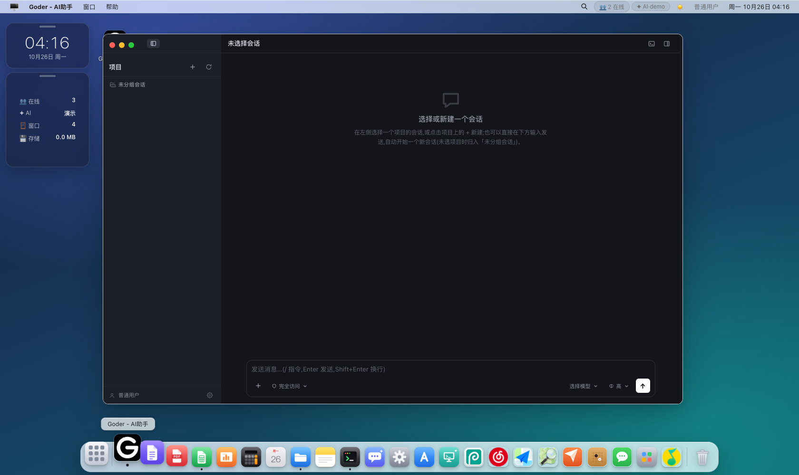
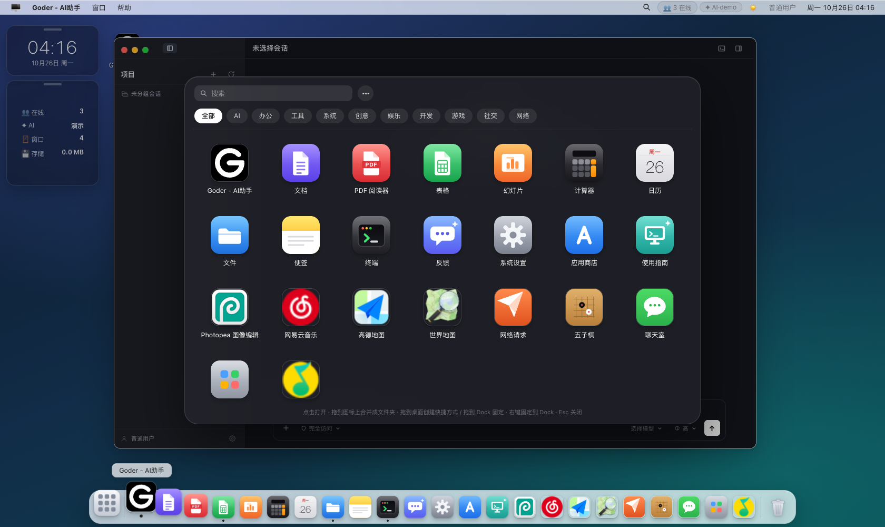

# OpenOS

仿 macOS 的**网页桌面操作系统**：单二进制 Go 后端 + Vue 3 前端，以 WebSocket 事件总线为核心通信，内置 goder **AI 编程 IDE**——AI 不只写代码，还能操控整个桌面。面向产品级使用：多用户权限、安全加固、审计日志与容器化部署。

[](LICENSE)     [](https://openos.gorun.fun/)

**👉 在线演示：<https://openos.gorun.fun>**

| 演示账号 | 密码 | 角色 |
|---|---|---|
| `admin` | `admin123` | 管理员（可见全部应用与设置） |
| `user` | `user123` | 普通用户 |
| `guest` | `guest123` | 访客 |

<p align="center">
  
</p>
<p align="center">
  <em>桌面：文件管理、终端与 goder AI 编程 IDE 同屏协作，共享同一份用户 home 目录</em>
</p>
<p align="center">
  
</p>
<p align="center">
  <em>启动台：内置应用之外，网易云音乐 / 高德地图 / Photopea 等均为零代码收录的网页应用</em>
</p>

## 目录

- [核心特性](#核心特性)
- [快速开始](#快速开始)
- [接入 AI](#接入-ai)
- [架构](#架构)
- [开发你的应用](#开发你的应用)
- [goder：AI 编程 IDE 与桌面控制](#goderai-编程-ide-与桌面控制)
- [应用商店](#应用商店)
- [桌面客户端](#桌面客户端)
- [配置参考](#配置参考)
- [生产部署](#生产部署)
- [安全](#安全)
- [项目结构](#项目结构)
- [参与开发](#参与开发)

深入指南见 [`docs/`](docs/README.md)：[Docker 部署](docs/deploy-docker.md) · [自部署](docs/deploy-bare-metal.md) · [配置参考](docs/configuration.md) · [安全说明](docs/security.md) · [应用开发](docs/app-development.md) · [宿主集成](docs/host-integration.md) · [goder 与桌面控制](docs/goder.md) · [统一代理](docs/webproxy.md) · [桌面客户端](docs/desktop-client.md) · [常见问题](docs/faq.md)

## 核心特性

### 🖥 完整的桌面体验

窗口管理（拖拽、八向缩放、边缘吸附半屏/最大化、焦点层级、跨会话恢复）、**聚焦搜索**（⌘/Alt+Space：应用 + 文件搜索 + 即时计算器）、启动台（F4）、可定制 Dock（拖动排序、邻居放大、废纸篓）、**应用切换器**（Alt+Tab 按住循环、松开切换）、深浅色主题、壁纸、桌面小组件（时钟 / 便签 / 日历）、**通知中心**（右上角横幅 + 菜单栏时钟唤出的历史面板 + 勿扰模式）、PWA 安装到桌面、中英文界面。

### 📦 开箱即用的内置应用

- **文件管理**（访达拟合）：图标 / 列表 / 分栏 / 画廊四视图、拖拽移动、多选、原位重命名、废纸篓、图片缩略图、递归搜索、**跨用户分享链接**
- **办公三件套 + PDF**：文档、表格、幻灯片直接读写云端文件，双击即开
- **真实终端**：服务端 `sh -c` 受控执行，ANSI 彩色（默认关闭，见 [安全](#安全)）
- **日历**：中国节假日（内置 + 在线同步，含调休标记）、农历、日程到期经通知中心提醒
- 便签（可钉到桌面）、计算器、系统设置、反馈、使用指南

### ✦ 内置 AI：goder 编程 IDE

- 每用户独立的 AI 编程工作台（项目 / 会话 / 聊天 / 代码审查 / 事件台），与文件管理、终端共享同一份 home 目录——AI 修改的文件在文件应用里即刻可见
- 兼容**任意 OpenAI 风格接口**：系统设置里填 Base URL / API Key / 模型名即接入，密钥仅存服务端
- **AI 可操控桌面**：内置 openos MCP 插件，AI 能开窗排列窗口、切换壁纸、读写文件、发通知、调用任意应用声明的能力
- **能力暴露层（CAP）**：应用按标准清单声明 `queries / actions / views` 三类能力，AI 经 4 个通用工具（`os_caps / os_app_query / os_app_call / os_app_ui`）发现与执行——**新应用接入不需要改服务端**

### 🔌 开放能力

四种接入方式覆盖从零代码到完整业务系统（详见 [开发你的应用](#开发你的应用)）：

| 方式 | 适合 | 代码量 |
|---|---|---|
| ① 声明式应用 | 数据看板、公告板、监控面板 | 一份 JSON |
| ② 组件 SDK | 轻交互工具、原型 | 一个组件 |
| ③ 宿主框架集成 | 把 OpenOS 当桌面框架，构建完整业务系统 | 一个前端工程 |
| ④ 网页应用 | 收录现成网站 | 零代码 |

配套：**应用商店**（远程目录、组件应用、自动升级与回滚）、**统一代理**（服务端反代让设防站点也能嵌入）、跨应用弹窗 / 拉起窗口等结果协议、事件总线多端联动。

### 🛡 多用户与产品级工程

- JWT 登录（防爆破锁定、令牌热吊销）、角色 × 应用授权矩阵、功能级权限点、审计日志
- 每用户独立磁盘 home（配额隔离），用户级数据云端持久化、多端一致
- 单二进制 + SQLite（纯 Go 驱动，`CGO_ENABLED=0` 可交叉编译）、Docker 部署、六平台桌面客户端
- 优雅停机、数据保留期自动清理、SSO / 令牌交换 / JWT 内省等宿主互通能力

## 快速开始

### Docker（最快）

```bash
git clone https://github.com/gorun-fun/openos.git && cd openos

# 准备构建上下文（goder 源码 + gh 二进制，Dockerfile 以 COPY 消费，缺了无法构建）
mkdir -p .run
git clone --depth 1 https://git.gorun.fun/share/goder.git .run/goder-src
VER=$(sh .run/goder-src/scripts/version.sh gh)
curl -fsSL -o .run/gh "https://download.gorun.fun/grf-harness/linux/${VER}/gh" && chmod +x .run/gh
# （arm64 机器把 linux 换成 linux-arm64）

OPENOS_DATA_DIR=./data docker compose up -d --build
# → http://localhost:8091（数据持久化在 ./data）
```

镜像自带 goder 全套组件（goder-serve 网关 + 嵌入库 + gh），构建一次、部署即用。完整流程（升级、备份、HTTPS 反代）见 [Docker 部署指南](docs/deploy-docker.md)；裸机 / 二进制部署见[自部署指南](docs/deploy-bare-metal.md)。

### 从源码运行

```bash
# 开发模式：后端 :8081 + 前端 :5173 热更新
make dev

# 或分步运行
cd server && go run .                     # 后端 → http://127.0.0.1:8081
cd web && npm install && npm run dev      # 前端 → http://localhost:5173

# 生产构建：单二进制 + 静态目录
make build && cd server && ./openos-server

# 多平台发布包（darwin/linux × amd64/arm64）
make release
```

> 本地裸机要使用 goder AI IDE 时，先执行 `make goder` 构建其组件（源码自动克隆，需 go/npm/git，且 PATH 上需有 gh 可执行文件——goder 的运行期依赖，可用 `OPENOS_GH_BIN` 指定路径）；组件缺失时 goder 应用内会显示部署引导，不影响 OpenOS 其余功能。

**默认账号**：`admin/admin123`（管理员）· `user/user123`（普通）· `guest/guest123`（访客）。
⚠️ 部署到任何可访问环境后，请立即在「系统设置 → 账户」修改默认密码。

## 接入 AI

**推荐：界面配置（即时生效，无需重启）**——管理员进入「系统设置 → AI 服务」，填入任意 OpenAI 兼容接口的 Base URL、API Key 与模型名，可一键「测试连接」。密钥仅存服务端，界面始终脱敏。

也可通过环境变量在首次启动时回填：

```bash
export OPENOS_AI_BASE_URL=https://open.bigmodel.cn/api/paas/v4
export OPENOS_AI_API_KEY=sk-xxx
export OPENOS_AI_MODEL=glm-4-flash
```

未配置时，AI 相关能力运行于本地演示模式（如终端 `ai` 指令、`/api/ai/chat` 开放接口）。

## 架构

```
┌────────────────────────── 浏览器 ──────────────────────────┐
│  Desktop Shell（菜单栏 / Dock / 启动台 / 窗口管理器）       │
│  ├── 基础 UI 库（OsButton / OsInput / OsTable / OsForm…）  │
│  ├── App SDK（registerApp 组件型 · SchemaApp 声明式）      │
│  └── 应用（文件/终端/办公三件套/日历/goder/商店应用/网页应用）│
│        │ REST /api/*                │ WS /ws（事件总线）   │
└────────┼────────────────────────────┼─────────────────────┘
         ▼                            ▼
┌─────────────────── Go 服务端（单二进制）───────────────────┐
│  auth(JWT+防爆破)  apps(注册+角色授权)  bus(事件总线 Hub)   │
│  vfs(磁盘 home+配额+分享)  ai(热更配置+流式)  goder(子进程)  │
│  market(商店)  webproxy(统一代理)  attach(附件)  audit     │
│     SQLite（WAL，纯 Go 驱动）      homes/<user>（磁盘 home）│
└───────────────────────────────────────────────────────────┘
```

### 事件总线

WebSocket 为核心通信通道：主题订阅 / 发布，`*` 结尾为前缀通配，发布不回声发布者，断线自动重连并重放订阅。

```jsonc
// 客户端 → 服务端
{ "action": "sub",  "topics": ["sys:*", "fs:changed"] }      // 订阅
{ "action": "pub", "topic": "app:calc", "payload": {...} }   // 发布

// 服务端 → 客户端
{ "topic": "app:calc", "payload": {...}, "from": "alice", "ts": 1760000000 }
```

前端任意组件（含第三方应用）`bus.emit` 一行广播、`bus.on` 一行订阅，跨标签页 / 跨设备即达：

```ts
import { bus } from '@/bus/bus'
bus.on('app:rooms', (payload, from) => refresh(payload))  // 订阅（支持通配）
bus.emit('app:rooms', { floor: 3 })                        // 本地 + 远程发布
```

内置主题示例：`sys:notify`（通知）、`sys:presence`（在线状态）、`fs:changed`（文件变更）、`sys:apps-changed`（应用列表变化）、`chat:room`（聊天室）。业务应用自定义 `app:<名>` 主题即插即用。

### 统一 home

每个用户在服务端有一份真实磁盘目录（`<data>/homes/<用户>`）：文件管理、真实终端、goder 项目**共用同一份文件树**——终端 `echo hi > a.md`、AI 在项目里改代码、文件应用刷新所见完全一致。REST 读写有配额（100MB / 单文件 8MB）与符号链接越界校验；绕过 REST 的直接写盘由服务端指纹轮询兜底广播 `fs:changed`。

## 开发你的应用

> 本节是速览；完整参考（dataSource 全字段、SDK 全 API、跨应用协议细节）见[应用开发指南](docs/app-development.md)，宿主框架深度集成见[宿主集成指南](docs/host-integration.md)，网页应用反代细节见[统一代理指南](docs/webproxy.md)。

### 方式一：声明式应用（零前端代码）

管理员在「系统设置 → 第三方应用」粘贴 JSON Schema 注册，立即可用并授权给任意角色：

```jsonc
{
  "title": "团队公告板",
  "dataSource": {
    "kind": "rest",                       // 或 "static"（内联数据）
    "url": "/api/announcements",          // 相对路径自动携带登录态
    "path": "data.items",                 // 响应取值路径
    "interval": 30,                       // 可选：轮询秒数
    "topic": "app:announcements"          // 可选：收到该总线消息立即刷新
  },
  "views": [
    { "type": "stats", "fields": [{ "key": "title", "label": "最新" }] },
    { "type": "table", "title": "列表", "columns": [
      { "key": "title", "label": "标题" }, { "key": "author", "label": "作者" }] }
  ]
}
```

视图类型：`stats` 指标卡 / `cards` 卡片 / `table` 表格；跨域接口默认经统一代理转发（`direct: true` 可强制直连）。

### 方式二：组件 SDK（完整前端能力）

第三方脚本（控制台、注入或商店 bundle 应用）调用全局 SDK：

```js
OpenOS.registerApp('todo', {
  name: '待办', width: 420, height: 400,
  component: {
    data: () => ({ items: ['体验 OpenOS'], text: '' }),
    template: '<div style="padding:16px">…</div>',
  },
})
OpenOS.open('todo')
```

SDK 面：`OpenOS.bus`（事件总线）/ `OpenOS.api`（带登录态的 REST 客户端）/ `OpenOS.ui`（基础组件库）/ `OpenOS.open` / `OpenOS.openFile`（按扩展名分发应用打开）/ `OpenOS.toast` / `OpenOS.notify` / `OpenOS.launch`（拉起窗口并等待结果）/ `OpenOS.openDialog`（跨应用弹窗）/ `OpenOS.me()` / `OpenOS.can(perm)`（权限判定）/ `OpenOS.vue`（Vue 具名导出）等。

### 方式三：宿主框架集成（面向完整业务系统）

**不 fork 壳代码**，把 OpenOS 当桌面基础框架消费：宿主前端以 `createOpenOS()` 组装桌面，注入业务应用、图标、品牌、SSO 与主题：

```ts
// 宿主前端入口（vite alias: @openos → openos 的 web/src）
import { createOpenOS } from '@openos/framework'

createOpenOS({
  apps: { rooms: () => import('./apps/Rooms.vue') },     // 业务应用
  icons: { rooms: { svg: '<svg…>' } },                   // 业务图标
  login: { mode: 'sso', url: '/api/auth/sso/login' },    // 登录跳宿主 SSO
  brand: { name: '业务系统', logo: '🏨' },
  theme: { accent: '#e5484d' },                          // 全局强调色
  capabilities: {                                        // 把业务能力暴露给 AI（见下节）
    rooms: {
      queries: [{ name: 'vacant', title: '查询今日空房', http: { url: '/api/rooms/vacant' } }],
      actions: [{ name: 'block', title: '锁定房型', run: (args) => hotelApi.post('/rooms/block', args) }],
      views: [{ name: 'grid', title: '房态盘', props: { view: 'grid' }, anchor: 'room-grid' }],
    },
  },
})
```

服务端配套**令牌交换**：宿主完成自身认证后，服务端到服务端换取 OpenOS 身份（首次出现的用户自动开通）：

```bash
OPENOS_EXCHANGE_SECRET=<共享密钥> ./openos-server

# 宿主后端调用（把返回的 token 交给前端即完成登录）：
curl -X POST http://127.0.0.1:8081/api/auth/exchange \
  -H 'X-Exchange-Secret: <共享密钥>' -H 'Content-Type: application/json' \
  -d '{"username":"zhang","role":"front","displayName":"张前台"}'
# → { "token": "<openos JWT>", "user": {...} }
```

宿主还能获得：反向互通 `POST /api/auth/introspect`（业务后端验证 OpenOS JWT，RFC 7662 风格）、机对机 API 组 `/api/host/*`（用户 / 角色 / 应用 / AI 供应商管理）、`POST /api/host/declare`（宿主角色与权限声明式投影，权威存储留在宿主）、批量用户同步、`OPENOS_VFS=off` 等裁剪开关（业务文件交由宿主管理）、App 独立发布通道（业务 App 热发布，不打宿主镜像）。

### 方式四：网页应用（收录现成站点）

不需要对方提供任何代码，把现成网站直接嵌成桌面应用。管理员在「系统设置 → 第三方应用 → 添加网页应用」填名称与地址即可，图标自动取站点 favicon，按角色授权后 Dock 即时出现。

两条路径：

- **iframe 直嵌**：目标站未设防嵌头（`X-Frame-Options` / `frame-ancestors`）时默认形态，跨域天然隔离、双方脚本无法互访；
- **统一代理（服务端反代）**：勾选「应用代理」后经 OpenOS 服务端反代加载——剥掉防嵌响应头、重写页面内全部地址、收归目标站 Cookie，内部系统与设防站点（如 GitHub）都能在窗体内打开；可选配置固定请求头（内网系统按 `Authorization` 鉴权）与页面内注入脚本（宿主平台业务接管管道）。

安全边界：代理目标仅来自管理员配置；SSRF 防线在拨号层（配置目标放行、其余拒绝内网地址）；转发前剥离 OpenOS 自身会话；访问权逐请求按角色授权矩阵校验。经代理加载的页面与桌面同源执行，**仅配置可信应用**。

### 跨应用联动

- **拉起弹窗拿结果**：`await OpenOS.openDialog('roommgmt:checkin', { roomId })`——跨应用业务弹窗，Esc / 遮罩自动取消
- **拉起窗口拿结果**：`await OpenOS.launch('roommgmt', { view: 'checkin', roomId })`——目标应用经 `launchOf` / `resolveLaunch` 回执结果，关窗即取消、永不悬空
- **跨应用实时同步**：数据权威在后端，前端走 `bus.emit('app:<名>:changed', …)` 广播变更，各应用自行订阅刷新

## goder：AI 编程 IDE 与桌面控制

OpenOS 按 goder 官方嵌入约定（每用户独立 gh server 子进程 + 身份反代 + 嵌入式前端）把 goder 作为内置应用（完整参考见 [goder 指南](docs/goder.md)）：

- 每用户**独立进程与数据目录**，令牌不下发浏览器；`/goder-api/*` 反代时剥离伪造头并注入身份
- **项目目录落统一 home**：`~/goder/<项目名>` 是真实目录，AI 的项目上下文与文件管理 / 终端同盘可见
- Docker 镜像自带全套组件；本地裸机 `make goder` 一次构建（见 [快速开始](#快速开始)）；组件缺失时自动降级为应用内部署引导，不影响启动

### 桌面控制（openos MCP 插件）

goder 里的 AI 可经内置 MCP 插件操控当前用户桌面（goder 启用时自动部署，无需配置）：

| 类别 | 能力 |
|---|---|
| 系统与窗口 | 版本 / 在线用户查询，开 / 关 / 排列 / 吸附窗口，打开文件，切换深色与壁纸 |
| 文件 | 读写 / 搜索用户 home 文件（复用 REST 权限与配额，写入自动广播刷新） |
| 通知与总线 | 发系统通知（入通知中心）、向桌面发布任意总线主题（可驱动声明式应用刷新） |
| 应用能力 | 经能力暴露层 `os_caps / os_app_query / os_app_call / os_app_ui` 消费任何应用声明的 queries / actions / views |
| 管理 | 应用列表；用户目录与商店安装按功能权限点门控 |

硬边界：MCP 端点仅监听回环 + Bearer 令牌（按用户分发、令牌↔用户成对校验）；工具只作用于发起用户本人；写操作入审计。

轻量场景另有总线指令通道：向 `sys:cmd` 发 `{ "cmd": "open", "arg": "calculator" }` 即可开应用（支持 open / close / file / wallpaper / dark）。

> 服务端另内置「代码管家（steward）」引擎：GitLab / GitHub issue 同步 → 确认后经 Goder 会话自动修复 → 提交直推可选发版，App 经应用商店安装（`OPENOS_STEWARD=off` 下架，详见 [AGENTS.md](AGENTS.md)）。

### 能力暴露层（CAP）

应用暴露给 AI 的能力收敛为**一份标准清单**，任何应用按同一协议声明（内置应用代码注册 / 宿主 `createOpenOS({ capabilities })` / 运行期 `OpenOS.registerCapabilities` / 声明式应用 `agentCaps` 键），AI 经 4 个通用工具发现与执行：

- `queries` 只读查询（不开应用直接取数）· `actions` 业务操作 · `views` 可视化入口（开窗定位 + `data-os-cap` 锚点高亮 + 分步引导文案）
- 执行模式三选一：`run` 回调（桌面壳执行）/ `http` 声明式 REST / `window` 开窗带 props 路由
- 权限：能力可声明 `perm` 功能权限点做 UX 门控，**鉴权权威恒在数据所有方**

## 应用商店

内置「应用商店」应用：浏览目录 → 详情 → 管理员安装 / 更新 / 卸载，安装时选择授权角色，经 `sys:apps-changed` 广播实时出现在各端。

- **目录多源**：官方默认源 + 管理员自定义源（最多 10 个）并发拉取合并，同 id 自定义源优先；货架独立仓库维护，版本号与 openos 发版解耦
- **三档收录形态**：网页应用（收录现成站点）、声明式应用（纯 JSON）、**组件应用**（单文件 ESM，≤2MB，默认导出 Vue 组件，能力经 `window.OpenOS` 注入——安装时下载落盘，运行期不依赖外部源）
- **自动升级 + 按版本回滚**：全局自动升级默认开启，保留授权与本地历史版本；某个新版本有问题时手动切回旧版即自动跳过该版本
- 普通用户可浏览与使用已装应用，安装 / 更新仅管理员；`OPENOS_MARKET=off` 整体下架

## 桌面客户端

`openos-desktop`：CDP 驱动本机 Chrome 以 app 模式直开 OpenOS，关闭同源策略与站点隔离后网页应用 iframe **直连真实站点**——适合服务端反代难以覆盖的复杂站点（SSO / 风控 / Cookie 轮换）。内置跨站登录的 SameSite 三层 Cookie 桥、请求级头改写与版本自动更新。

```bash
make desktop          # 构建 → ./openos-desktop
./openos-desktop      # 首次先选服务器，之后可 -auto 直连
```

六平台发布（macOS / Linux / Windows × amd64 / arm64），更新通道 `download.gorun.fun/openos/cli`。详见[桌面客户端指南](docs/desktop-client.md)。安全边界：`--disable-web-security` 仅作用于专用 profile，CDP 端口只绑 127.0.0.1，勿指向不可信的 OpenOS 实例。

## 配置参考

关键环境变量（全部可选，均有合理默认；完整清单见[配置参考](docs/configuration.md)）：

| 变量 | 默认 | 说明 |
|---|---|---|
| `OPENOS_ADDR` | `127.0.0.1:8081` | 监听地址（容器内 `0.0.0.0:8081`） |
| `OPENOS_DATA` | `./data` | 数据目录（SQLite、用户 home、附件、goder 会话等） |
| `OPENOS_DIST` | 内嵌前端 | 前端静态目录（多实例共用时指向同一份 dist） |
| `OPENOS_JWT_SECRET` | 自动生成并持久化 | JWT 密钥；**多实例部署必须显式固定** |
| `OPENOS_TOKEN_TTL` | `24h` | 令牌有效期（Go duration），前端自适应续期 |
| `OPENOS_SEED_DEMO` | 开 | `0` = 不种默认演示账号与示例文件 |
| `OPENOS_REAL_SHELL` | `off` | 真实终端：`on` 受限执行 / `full` 解除目录限制；**公网部署保持 off** |
| `OPENOS_TRUST_PROXY` | 关 | `1` = 防爆破计数按 `X-Forwarded-For` 末位分桶（单层反代语义） |
| `OPENOS_AI_BASE_URL` / `_API_KEY` / `_MODEL` | — | AI 首启回填（之后以设置页在线配置为准） |
| `OPENOS_GODER` | 开 | `off` = 停用 goder（不启动子进程、下架应用） |
| `OPENOS_GODER_BIN` / `OPENOS_GODER_JS` / `OPENOS_GH_BIN` | 自动发现 | goder 组件路径 |
| `OPENOS_GODER_ADDR` | `127.0.0.1:7711` | goder-serve 网关地址（强制回环） |
| `OPENOS_OSMCP` / `OPENOS_OSMCP_ADDR` | 开 / `127.0.0.1:7712` | 桌面控制 MCP 插件开关与监听地址（强制回环） |
| `OPENOS_VFS` | 开 | `off` = 下架文件 / 终端类应用，`/api/fs/*` 503（宿主形态） |
| `OPENOS_MARKET` / `OPENOS_MARKET_URL` | 开 / 官方目录 | 商店开关 / 默认目录地址（`off` 只关官方源） |
| `OPENOS_PROXY` | 开 | `off` = 下架统一代理 `/app/*` 与 `/px/*` |
| `OPENOS_HOLIDAY_SYNC` | 开 | `off` = 日历只用内置节假日数据（纯内网） |
| `OPENOS_FS_WATCH` | 开 | `off` = 关闭绕过 REST 写盘的指纹轮询监控 |
| `OPENOS_EXCHANGE_SECRET` | 空 = 禁用 | 宿主间全信任密钥（令牌交换 / JWT 内省 / `/api/host/*` / declare） |
| `OPENOS_EXCHANGE_ROLES` | 空 | exchange 可铸造的角色白名单（强烈建议配置） |
| `OPENOS_ROOM_URL` | 空 | 游戏房间服务地址（商店游戏应用按此直连） |
| `OPENOS_AUDIT_RETENTION_DAYS` | `90` | 审计日志保留天数（0 = 永久） |
| `OPENOS_CHAT_RETENTION_DAYS` | `90` | 聊天记录保留天数（0 = 永久） |
| `OPENOS_ATTACH_RETENTION_DAYS` | `30` | 系统附件保留天数（0 = 永久） |

完整清单（含 steward 代码管家等进阶组件）见 [AGENTS.md](AGENTS.md)。

## 生产部署

- [ ] **修改默认密码**：admin / user / guest 三个默认账号，或删除不需要的账号
- [ ] **配置 AI 服务**：系统设置 → AI 服务（或环境变量首启回填）
- [ ] **HTTPS**：置于 Nginx / Caddy 反代之后（WebSocket 需配置 `Upgrade` / `Connection` 头）
- [ ] **备份**：定期备份 `OPENOS_DATA`（SQLite WAL + 用户 home 磁盘目录；停机拷贝或 `sqlite3 .backup` + rsync）
- [ ] **固定 `OPENOS_JWT_SECRET`**（多实例共享时必需）
- [ ] **公网部署保持 `OPENOS_REAL_SHELL=off`**（演示 compose 显式开启仅适用于受控环境）
- 数据模型：系统数据在单文件 SQLite（WAL），用户文件在 `homes/<用户>` 磁盘目录；部署细节见 [Docker 部署](docs/deploy-docker.md) / [自部署](docs/deploy-bare-metal.md)

发布方式：提交后打 tag 推送（`v0.0.x`，每次只递增末位）触发 CI 构建镜像并部署，详见 `.gitlab-ci.yml`。

## 安全

OpenOS 按产品级标准做了全面加固（2026-10 两轮安全审计后收紧，完整说明见[安全文档](docs/security.md)），要点：

- **认证**：密码 pbkdf2-SHA256（60 万轮 + 随机盐，旧 hash 登录自动升级）；JWT 带 token_version，但吊销仅限密码变更 / 重置——**身份与授权分离**：角色 / 权限 / 禁用变化实时生效且不掉线
- **会话**：无法携带 header 的场景（WS / 附件 / 商店组件）用 30s 一次性短票替代长期 JWT 入 URL；Cookie HttpOnly + SameSite=Strict；前端令牌滑动续期
- **防线**：登录防爆破（每 用户名+IP 10 分钟 8 次锁定）+ 全局限流 + 用户名枚举时序抹平；幻灯片 HTML / Markdown 链接做 XSS 白名单净化
- **文件**：严格限制在 `/home/<用户>`（单文件 ≤8MB、配额 100MB、2 万文件上限、符号链接越界校验），用户间完全隔离，写操作入审计
- **总线 ACL**：`sys:*` 广播收归服务端、他人终端主题不可旁路收听、客户端发布的系统主题仅投递本人
- **代理**：SSRF 防线在拨号层（域名单次解析校验后按 IP 直连，堵 DNS rebinding）；转发前剥 OpenOS 会话；目标站 Cookie 收归代理路径
- **子进程**：终端与 goder 子进程环境一律白名单化，绝不继承 `OPENOS_*` 秘密；goder-serve 与 MCP 端点强制回环绑定
- **数据治理**：审计 / 聊天 / 附件按保留期自动清理；AI 密钥仅存服务端、接口脱敏，goder 托管供应商走平台自身代理端点（平台 Key 不落任何用户盘）
- **如实声明**：终端 `on` 模式的「受限」仅限 cd / 工作目录跟踪，**不是文件系统沙箱**——命令以服务进程权限执行，公网部署保持 `off` 或由运维自行加固

## 项目结构

```
openos/
├── server/                  # Go 后端（单入口 main.go + internal/*）
│   └── internal/
│       ├── auth/            # JWT、防爆破、令牌交换与内省、用户管理
│       ├── bus/             # WebSocket 事件总线 Hub（含 ACL）
│       ├── vfs/             # 统一 home 磁盘 FS、配额、分享链接、真实终端
│       ├── goder/           # goder-serve 子进程托管 + 身份反代 + 宿主管理面
│       ├── osmcp/           # 桌面控制 MCP 插件（os_* 工具 + 能力暴露层）
│       ├── market/          # 应用商店（目录、安装、自动升级）
│       ├── webproxy/        # 统一代理（应用反代 + 通用转发，一套引擎）
│       ├── steward/         # 代码管家引擎（issue 同步 → AI 修复 → 推送发版）
│       ├── ai/              # AI 配置热更、SSE 流式、密钥脱敏
│       └── attach/          # 系统附件服务（上传 / 保留期）
├── web/                     # Vite + Vue 3 前端
│   └── src/
│       ├── desktop/         # Desktop / MenuBar / Dock / Launchpad / WindowFrame
│       ├── ui/              # Os* 基础组件库、键盘系统、菜单 / 弹窗 / 提示
│       ├── sdk/             # OpenOS 全局 SDK + SchemaApp 声明式渲染器
│       ├── bus/  api/       # 事件总线客户端 / REST 客户端
│       ├── apps/            # 内置应用（files terminal docs sheets slides …）
│       ├── framework.ts     # createOpenOS() 宿主组壳入口（公共 API 面）
│       └── tooling/         # 宿主构建工具（deps / host / app 三段构建）
├── desktop/                 # openos-desktop 桌面客户端（CDP 驱动 Chrome）
├── hostsdk/                 # 独立 Go module：宿主集成 SDK
├── Dockerfile               # 多阶段构建（node → go → alpine），非 root 运行
└── docker-compose.yml       # 数据卷持久化 → http://localhost:8091
```

## 参与开发

```bash
make dev                     # 本地开发（后端 :8081 + 前端 :5173）
make test                    # Go 单元测试（auth/bus/vfs/osmcp/webproxy…）
cd web && npm run typecheck  # 前端类型检查（vue-tsc）
```

- 深度架构文档与开发约定见 [AGENTS.md](AGENTS.md)（通信协议、安全不变量、各模块边界）
- 代码注释与文档使用中文
- 版本规则：`v0.0.x` 起每次发布只递增末位；打 tag 推送触发 CI

## 开源许可

本项目基于 [MIT License](LICENSE) 开源。

构建期拉取的外部组件（[goder](https://git.gorun.fun/share/goder) 等）遵循其各自的许可协议，不在本仓库 LICENSE 覆盖范围内。
